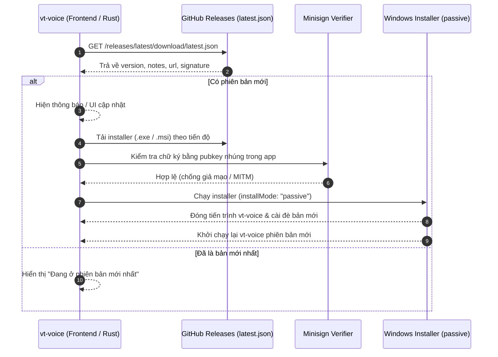

# Nghiên cứu giải pháp Auto-Update cho vt-voice (Tauri v2 trên Windows)

**Ngày thực hiện:** 2026-11-13 13:05 (+07:00)  
**Phạm vi:** Đánh giá kiến trúc, cấu hình, bảo mật, CI/CD và tích hợp UI/UX cho tính năng tự động cập nhật trên `vt-voice` (Tauri v2, Windows x64).

---

## Tóm tắt kết quả (Outcome)

Giải pháp tối ưu nhất (KISS, an toàn, ít bảo trì) là sử dụng plugin chính thức **`tauri-plugin-updater` (v2)** kết hợp **`tauri-plugin-process` (v2)** và hạ tầng **GitHub Releases** hiện có qua `tauri-apps/tauri-action@v0`.

- **Không cần tự viết downloader/replacer**: `tauri-plugin-updater` xử lý sẵn tải file, xác thực chữ ký mật mã **Minisign** (ed25519), chạy bộ cài Windows ở chế độ `passive` (không cần người dùng bấm Next), và tự đóng/cài đè ứng dụng an toàn.
- **Tương thích sẵn với quy trình release hiện tại**: Dự án đã có `scripts/bump-version.ts` (đồng bộ 3 file `package.json`, `Cargo.toml`, `tauri.conf.json`) và `.github/workflows/release.yml` (dùng `tauri-apps/tauri-action@v0`). Chỉ cần bổ sung signing key, bật `createUpdaterArtifacts: true` và cấu hình endpoint `latest.json`.
- **Phát hiện quan trọng từ codebase**: `tauri-plugin-single-instance = "2"` đã khai báo trong `src-tauri/Cargo.toml` nhưng **chưa được đăng ký** trong `src-tauri/src/lib.rs`. Cần kích hoạt plugin này để tránh chạy song song nhiều tiến trình gây lỗi lock file `.exe` khi cập nhật.

---

## Mục lục

1. [Kiến trúc & Luồng hoạt động](#1-kiến-trúc--luồng-hoạt-động)
2. [Đánh giá hiện trạng codebase vt-voice](#2-đánh-giá-hiện-trạng-codebase-vt-voice)
3. [Chi tiết cấu hình & tích hợp kỹ thuật](#3-chi-tiết-cấu-hình--tích-hợp-kỹ-thuật)
4. [Rủi ro, Edge Cases & Lưu ý đặc thù trên Windows](#4-rủi-ro-edge-cases--lưu-ý-đặc-thù-trên-windows)
5. [Bước tiếp theo (Actionable Next Steps)](#5-bước-tiếp-theo-actionable-next-steps)

---

## 1. Kiến trúc & Luồng hoạt động



---

## 2. Đánh giá hiện trạng codebase vt-voice

| Thành phần | Hiện trạng | Cần bổ sung / thay đổi |
| --- | --- | --- |
| `src-tauri/Cargo.toml` | Đã có `tauri = "2"`, `tauri-plugin-single-instance = "2"` | Thêm `tauri-plugin-updater = "2"`, `tauri-plugin-process = "2"` |
| `package.json` | Đã có `@tauri-apps/api` `^2.11.1` | Thêm `@tauri-apps/plugin-updater`, `@tauri-apps/plugin-process` |
| `src-tauri/tauri.conf.json` | `"bundle": { "active": true, "targets": "all" }` | Thêm `"createUpdaterArtifacts": true` và block `"plugins.updater"` |
| `src-tauri/capabilities/default.json` | Chưa có quyền updater/process | Thêm `"updater:default"`, `"process:allow-restart"` |
| `src-tauri/src/lib.rs` | Chưa đăng ký `single-instance` và `updater` | Đăng ký `single_instance` (đầu tiên), `updater`, `process` |
| `.github/workflows/release.yml` | Dùng `tauri-apps/tauri-action@v0`, chưa ký artifact | Thêm `TAURI_SIGNING_PRIVATE_KEY` và bật tạo/upload `latest.json` |
| `src/components/settings/GeneralTab.tsx` | Chưa có mục phiên bản & kiểm tra cập nhật | Thêm UI kiểm tra cập nhật, progress bar, toggle auto-check |
| `src/locales/{vi,en}.json` | Đầy đủ i18n hiện tại | Bổ sung key song ngữ `vi`/`en` cho UI updater |

---

## 3. Chi tiết cấu hình & tích hợp kỹ thuật

### 3.1. Tạo cặp khóa ký (Signing Keys)

Chạy một lần trên máy dev bằng Tauri CLI:

```bash
bun run tauri signer generate -- -w ~/.tauri/vt-voice.key
```

- **Public key** (`.key.pub`): Nhúng công khai vào `src-tauri/tauri.conf.json`.
- **Private key** (`.key`): Lưu vào GitHub Repository Secrets với tên `TAURI_SIGNING_PRIVATE_KEY` (và `TAURI_SIGNING_PRIVATE_KEY_PASSWORD` nếu đặt mật khẩu). **Tuyệt đối không commit private key lên git.**

### 3.2. Cấu hình `src-tauri/tauri.conf.json`

```json
{
  "bundle": {
    "active": true,
    "targets": "all",
    "createUpdaterArtifacts": true
  },
  "plugins": {
    "updater": {
      "pubkey": "NỘI_DUNG_FILE_PUBLIC_KEY",
      "endpoints": [
        "https://github.com/hvantoan/vt-voice/releases/latest/download/latest.json"
      ],
      "windows": {
        "installMode": "passive"
      }
    }
  }
}
```

- `installMode: "passive"`: Hiển thị thanh tiến trình cài đặt nhỏ gọn của Windows installer và tự chạy xong không bắt người dùng bấm xác nhận nhiều bước (phù hợp nhất cho app chạy nền). Các lựa chọn khác: `"basicUi"` hoặc `"quiet"`.

### 3.3. Cấu hình GitHub Actions (`.github/workflows/release.yml`)

Trong step `Build Tauri and Publish Release` sử dụng `tauri-apps/tauri-action@v0`:

```yaml
      - name: Build Tauri and Publish Release
        uses: tauri-apps/tauri-action@v0
        id: tauri-build
        env:
          GITHUB_TOKEN: ${{ secrets.GITHUB_TOKEN }}
          TAURI_SIGNING_PRIVATE_KEY: ${{ secrets.TAURI_SIGNING_PRIVATE_KEY }}
          TAURI_SIGNING_PRIVATE_KEY_PASSWORD: ${{ secrets.TAURI_SIGNING_PRIVATE_KEY_PASSWORD }}
        with:
          tauriScript: bun run tauri
          tagName: ${{ steps.release-tag.outputs.tag }}
          releaseName: 'vt-voice ${{ steps.release-tag.outputs.tag }}'
          releaseBody: ${{ steps.git-cliff.outputs.content }}
          releaseDraft: ${{ inputs.draft || false }}
          prerelease: ${{ inputs.prerelease || false }}
          uploadPlainBinary: true
          includeUpdaterJson: true
```

> Lưu ý: Tùy phiên bản minor bên trong `tauri-action@v0`, tham số tạo `latest.json` có thể là `includeUpdaterJson: true` hoặc `uploadUpdaterJson: true` (hệ thống sẽ tạo và upload `latest.json` cùng các file `.sig` lên GitHub Release).

### 3.4. Đăng ký Plugin trong Rust (`src-tauri/src/lib.rs`)

```rust
tauri::Builder::default()
    // Đăng ký single-instance ĐẦU TIÊN để tránh xung đột file lock khi update
    .plugin(tauri_plugin_single_instance::init(|app, _argv, _cwd| {
        if let Some(win) = app.get_webview_window("main") {
            let _ = win.unminimize();
            let _ = win.show();
            let _ = win.set_focus();
        }
    }))
    .plugin(tauri_plugin_opener::init())
    .plugin(tauri_plugin_process::init())
    .plugin(tauri_plugin_updater::Builder::new().build())
    // ... các plugin hiện có
```

### 3.5. Luồng kiểm tra & cài đặt ở Frontend (TypeScript)

```typescript
import { check } from "@tauri-apps/plugin-updater";
import { relaunch } from "@tauri-apps/plugin-process";

const update = await check();
if (update) {
  let downloaded = 0;
  let total = 0;

  await update.downloadAndInstall((event) => {
    switch (event.event) {
      case "Started":
        total = event.data.contentLength ?? 0;
        break;
      case "Progress":
        downloaded += event.data.chunkLength;
        break;
      case "Finished":
        break;
    }
  });

  await relaunch();
}
```

---

## 4. Rủi ro, Edge Cases & Lưu ý đặc thù trên Windows

1. **Private vs Public GitHub Repo**:
   - Endpoint `https://github.com/hvantoan/vt-voice/releases/latest/download/latest.json` chỉ hoạt động trực tiếp không cần xác thực khi repository ở chế độ **Public**.
   - Nếu repo là **Private**, người dùng cuối sẽ gặp lỗi `404` khi gọi `check()` trừ khi bạn dùng một proxy/update server riêng có token hoặc chuyển repo sang Public.
2. **Hành vi thoát app khi cài đặt (NSIS vs MSI)**:
   - Trên Windows dùng NSIS (`-setup.exe`), khi `downloadAndInstall()` chạy xong, bộ cài NSIS sẽ tự động đóng tiến trình `vt-voice.exe` đang chạy để ghi đè file và khởi động lại app. Lệnh `relaunch()` phía sau chỉ mang tính dự phòng (ví dụ cho gói MSI).
   - Vì `vt-voice` sử dụng low-level keyboard hook (`WH_KEYBOARD_LL`) và System Tray, cần đảm bảo app thoát sạch khi nhận tín hiệu đóng từ installer (không bị treo hook thread).
3. **Mất Private Key**:
   - Nếu làm mất `TAURI_SIGNING_PRIVATE_KEY` hoặc đổi sang key mới, các bản `vt-voice` đã cài trên máy người dùng sẽ **không thể tự cập nhật** lên bản ký bằng key mới (chữ ký không khớp `pubkey`), buộc phải tải bộ cài thủ công một lần.
4. **Cửa sổ Settings đang ẩn (Tray App)**:
   - Khi ứng dụng khởi động ở chế độ `--minimized` (chỉ hiện Tray icon), nếu tự động kiểm tra phát hiện có bản mới: không nên tự ý tải và khởi động lại ngang khi người dùng đang gõ phím bằng giọng nói (`Listening` / `Processing`). Nên hiển thị thông báo/badge hoặc đợi người dùng bấm xác nhận "Cập nhật ngay".
5. **Chế độ Dev (`bun run tauri dev`)**:
   - `tauri-plugin-updater` có thể báo lỗi hoặc bỏ qua check trong môi trường dev nếu chưa cấu hình hoặc version dev trùng với release. Cần bắt lỗi (`try/catch`) và map qua `translateIpcError` hoặc thông báo nhẹ nhàng khi kiểm tra thất bại (ví dụ mất mạng).

---

## 5. Bước tiếp theo (Actionable Next Steps)

1. **Xác nhận điều kiện tiên quyết**:
   - Xác nhận repo `hvantoan/vt-voice` là Public (hay Private).
   - Tạo cặp khóa Minisign và lưu `TAURI_SIGNING_PRIVATE_KEY` vào GitHub Secrets.
2. **Triển khai cấu hình & backend**:
   - Cài đặt `tauri-plugin-updater` + `tauri-plugin-process` (Cargo & Bun).
   - Cập nhật `tauri.conf.json`, `capabilities/default.json`, `lib.rs` (gồm cả `single-instance`), và `release.yml`.
3. **Triển khai UI & Config**:
   - Thêm tùy chọn `auto_check_updates: bool` (mặc định `true`) vào `AppConfig`.
   - Thêm khu vực "Cập nhật ứng dụng" trong `GeneralTab.tsx` (hiển thị version hiện tại, nút kiểm tra, thanh tiến trình tải, nút cài đặt) cùng key i18n cho `vi.json` / `en.json`.
4. **Kiểm thử End-to-End**:
   - Tạo một bản Draft Release hoặc Pre-release (ví dụ `v0.1.3-rc.1`) bằng workflow để xác minh GitHub Actions sinh đúng `latest.json` + `.sig`, và app bản cũ (`v0.1.2`) kiểm tra, tải và tự nâng cấp thành công.
